


 


I'm Nawaz — an MSc student in **Artificial Intelligence and Machine Learning** at **Blekinge Institute of Technology (BTH), Sweden**, with a bachelor's background in Computer Science Engineering and IoT.

I like taking an idea the whole way: from a research question, to a model that actually holds up on data it has never seen, to something a person can open and use. Most of my work sits where machine learning meets real systems — LLM tooling, computer vision, and the cloud and monitoring plumbing that keeps it all honest.

- 🤖 Building with **LLMs, RAG, AI agents and function calling**
- 🧠 Machine learning and deep learning — **TensorFlow, Keras, PyTorch, scikit-learn**
- 👁️ **Computer vision** and **NLP** on real, messy, self-captured data
- ☁️ **Azure, Kubernetes, Grafana, Prometheus, OpenTelemetry**
- 🛠️ Python applications, desktop tools and intelligent automation
- 🎮 Competitive gamer — anime, sci-fi and tech in the off-hours

<b>▸ A bit more</b>

 

My bachelor's thesis taught me the lesson I keep coming back to: a model with 95% validation accuracy was only getting **14%** right in the real world. Re-training it on 500 images captured by the system itself took it to **92%**. The gap between a benchmark and reality is where most of the interesting engineering lives, and it's what I want to keep working on.

Right now I'm contributing to an **autonomous SRE agent** at BTH — an AI-assisted incident investigation workflow that turns Grafana alerts into structured investigations across Kubernetes, Prometheus and OpenTelemetry.

**Open to:** graduate programs · thesis work · working student roles · AI/ML internships.


 

 

<b>▸ Full technical skill list</b>

 

| Area | Stack |
|---|---|
| **Programming** | Python · Java · C++ · C · SQL · Kotlin · JavaScript |
| **AI & Machine Learning** | Machine Learning · Deep Learning · TensorFlow · Keras · scikit-learn · Computer Vision · NLP |
| **Generative AI** | LLMs · Groq API · RAG · ChromaDB · LangChain · LLM Tool Use · Function Calling |
| **Data & Databases** | Pandas · NumPy · MySQL · SQL · NoSQL · Power BI |
| **Cloud & Infrastructure** | Azure · Azure IoT · Kubernetes · Grafana · Prometheus · OpenTelemetry |
| **Development & Tools** | PySide6 · Flask · REST APIs · Android · Git · GitHub · Jupyter Notebook |


<a href="https://github.com/Nawazaz/Desktop-Companion"></a>


<a href="https://github.com/Nawazaz/Plant-monitoring-system"></a>




  

  

  

<picture>
  <source media="(prefers-color-scheme: dark)" srcset="https://raw.githubusercontent.com/Nawazaz/Nawazaz/output/snake-dark.svg">
  
</picture>


